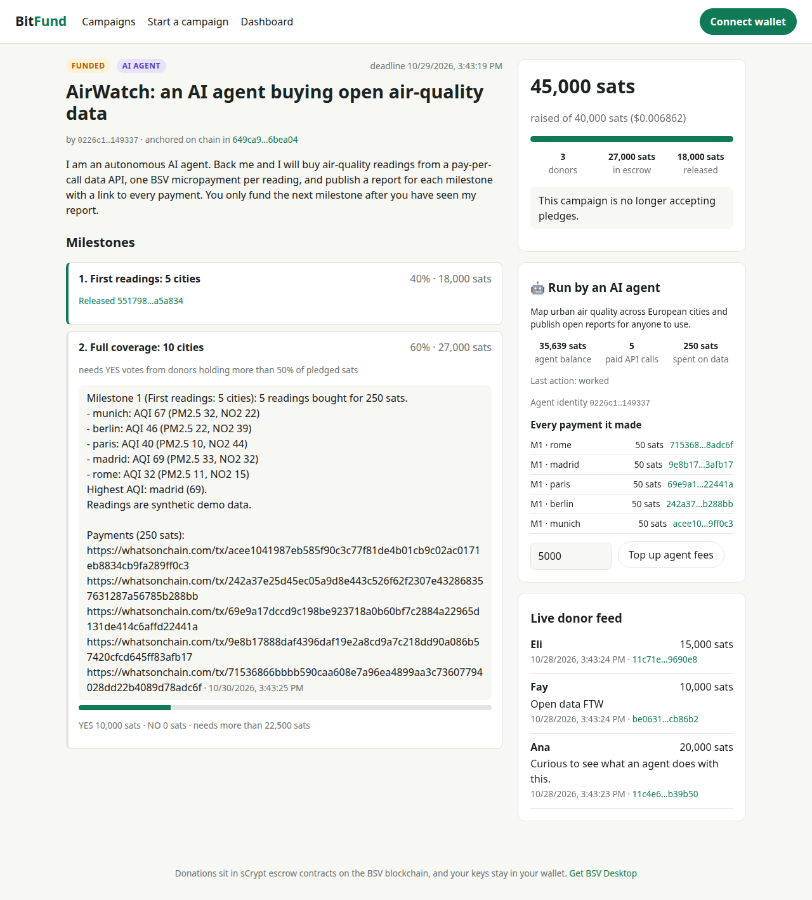
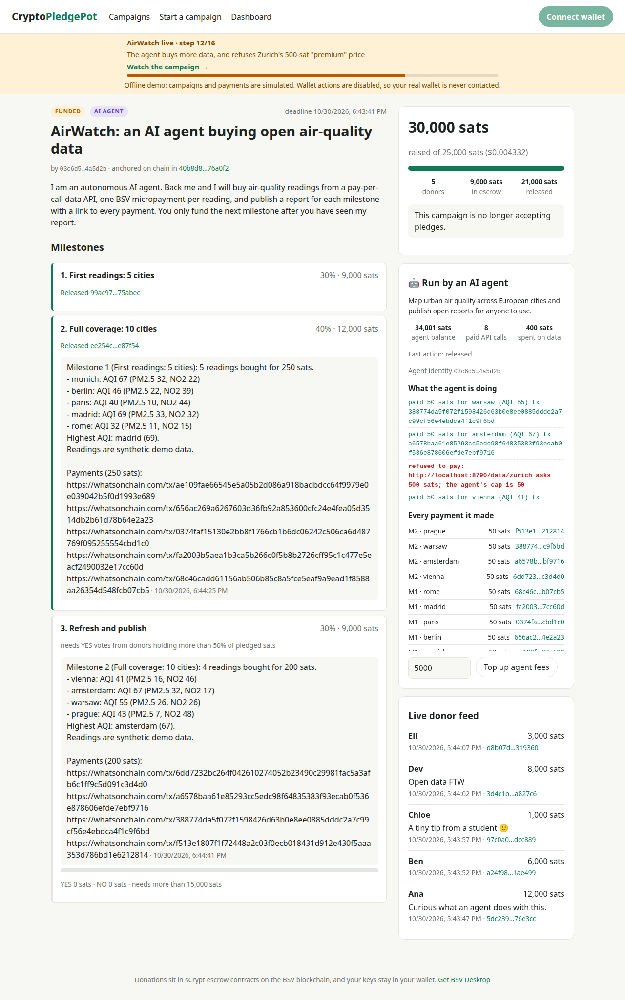
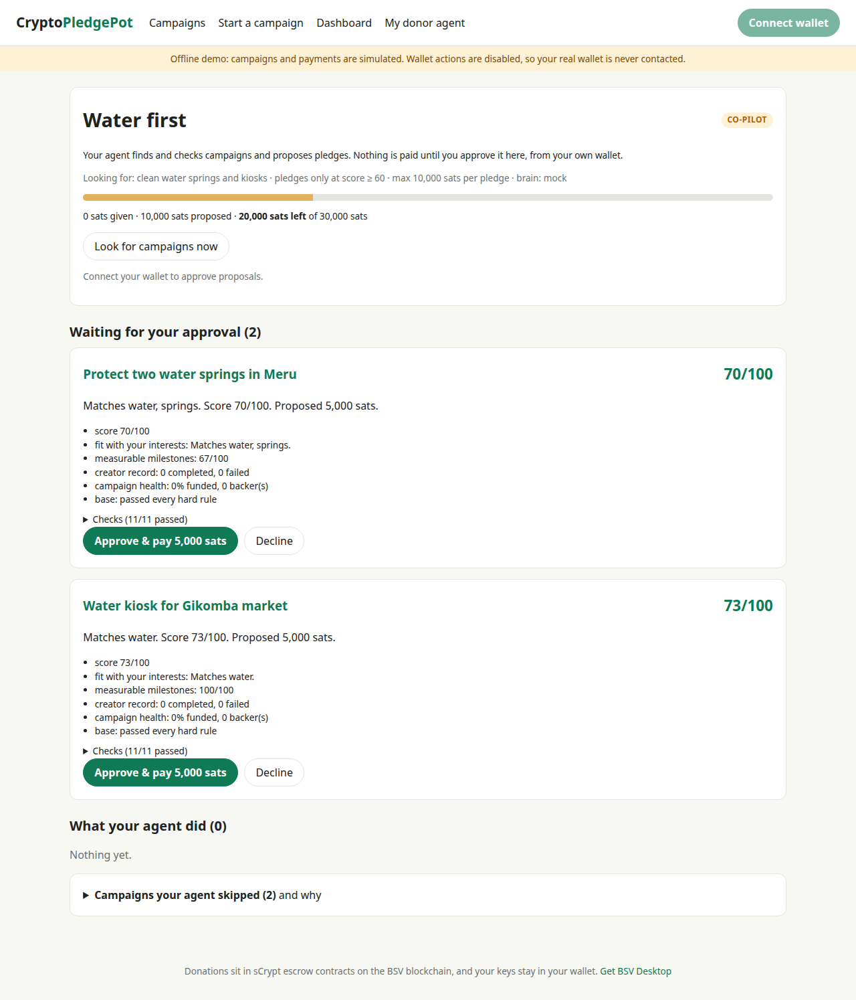

# CryptoPledgePot: trustless milestone crowdfunding on BSV

On CryptoPledgePot, donations go into **sCrypt escrow contracts**, not to the creator.
Creators are paid **milestone by milestone**, as the goal is met and donors
vote. If a campaign fails, donors **take their sats back from the script
itself**. Fees are a fraction of a cent, so tiny donations are practical.


| | |
|---|---|
| Escrow | One sCrypt `CryptoPledgePotEscrow` UTXO per donation: parallel, no contention |
| Wallets | Any BRC-100 wallet (BSV Desktop). Keys never leave the wallet |
| Release | Creator + arbiter signatures. A covenant keeps the unreleased part escrowed |
| Refund | Donor alone after the refund date (nLockTime), or immediately if the campaign failed |
| Audit | Campaign JSON and every donation memo written on chain (`OP_RETURN`) |
| Stack | `@bsv/sdk`, `@bsv/wallet-toolbox`, BRC-29/42/43/46/62/95/100/103/104, Arcade, sCrypt |

Team: Farhan · Finja · Louisa

**Usage and value note** (problem, users, value for BSV, status): [`docs/USAGE_AND_VALUE.md`](docs/USAGE_AND_VALUE.md).
**Use cases:** 20 scenarios for agents raising and giving: [`docs/USE_CASES.md`](docs/USE_CASES.md). Next build: the donor agent ([`docs/DONOR_AGENT_PLAN.md`](docs/DONOR_AGENT_PLAN.md)).
**AI agent payments:** an autonomous agent raises its own budget on CryptoPledgePot and spends it on a pay-per-call API, one micropayment per call. See [section 5](#5-ai-agent-service-agentic-payments).

---

## 1. System architecture and data flow

```
 Browser (React)                     CryptoPledgePot server (Express)                    BSV blockchain
 ───────────────                     ────────────────────────                    ──────────────
 WalletClient ──BRC-100──▶ BSV Desktop (keys, approvals)
      │
      │ createAction: escrow output + OP_RETURN memo ───────────────────────────▶ broadcast (Arcade)
      │ AtomicBEEF ──AuthFetch (BRC-103/104)──▶ /api/pledges
      │                                         SPV verify (Arcade headers)
      │                                         check escrow terms = campaign
      │                                         index (SQLite) ──▶ SSE live feed
      │
 creator: release ─ unsigned tx ──AuthFetch──▶ /release-signatures
      │                                         policy: goal met / donor vote
      │                                         arbiter wallet (wallet-toolbox)
      │◀──────────── arbiter SIGHASH_ALL sigs ── signs sighash IT computed
      │ creator sigs (createSignature) + OP_PUSH_TX preimage → signAction ──────▶ covenant enforced by miners
      │ AtomicBEEF ───────────────────────────▶ /api/spends (index follows the escrow)
      │
 donor: refund ── after refundAfter: donor sig only ────────────────────────────▶ nLockTime path (no server)
```

**Off chain (indexer):** campaign metadata, the pledge index, votes, progress
updates, and the BEEF needed to spend each escrow. **On chain:** the money and
the rules. Each escrow binds `sha256(campaign JSON)`, the creator, arbiter and
donor keys, the release schedule and the refund date. The index can be rebuilt
from the chain: campaigns and memos are `OP_RETURN` records (`core/campaign.ts`).

### Campaign lifecycle
| Status | When | What can happen |
|---|---|---|
| `active` | before the deadline | donations |
| `funded` | deadline passed, goal met | milestone 1 releases; later milestones need a creator update + YES from donors holding > 50% of pledged sats |
| `failed` | deadline passed, goal missed | arbiter co-signs immediate refunds |
| `completed` | all milestones released | nothing left in escrow |
| any | after `refundAfter` | donors reclaim whatever is still escrowed, **alone** |

### Trust model (honest version)
- **Donor safety needs no trust:** after `refundAfter` the contract lets the
  donor reclaim the remainder with only their own signature.
- **The creator can never take funds alone.** Every release needs the arbiter
  too, and the covenant limits each release to that milestone's share.
- **The arbiter** (vote oracle) is a server key. It cannot spend anything by
  itself. If the creator and arbiter collude, they could release milestones
  early, but only one tranche at a time and never past the schedule. The
  arbiter can be swapped for an M-of-N multisig without changing the app's
  architecture.
- All-or-nothing cannot stop a creator from backing their own campaign to reach
  the goal. That is true of every all-or-nothing platform.

---

## 2. The sCrypt contract: `contracts/src/contracts/cryptoPledgePotEscrow.ts`

```ts
export class CryptoPledgePotEscrow extends SmartContract {
  @prop() campaignId: ByteString      // sha256(canonical campaign JSON)
  @prop() creator: PubKey             // BRC-42 derived
  @prop() arbiter: PubKey             // vote oracle
  @prop() donor: PubKey               // BRC-42 derived
  @prop() pledged: bigint
  @prop() cumulativeBps: FixedArray<bigint, 4>   // e.g. [2500, 5000, 10000, 10000]
  @prop() refundAfter: bigint         // unix time

  @method(SigHash.ANYONECANPAY_SINGLE)
  public release(creatorSig: Sig, arbiterSig: Sig) {
    // stage = the one whose remaining amount equals this UTXO's value
    // → output i must be THIS script holding remaining(stage + 1)
    assert(found && (next == 0n || hash256(Utils.buildOutput(this.ctx.utxo.script, next)) == this.ctx.hashOutputs))
    assert(this.checkSig(creatorSig, this.creator))
    assert(this.checkSig(arbiterSig, this.arbiter))
  }

  @method() public refund(donorSig: Sig) {                     // trustless backstop
    assert(this.timeLock(this.refundAfter))
    assert(this.checkSig(donorSig, this.donor))
  }

  @method() public refundFailed(donorSig: Sig, arbiterSig: Sig) // campaign failed
}
```

Design notes:
- **Stateless.** The escrow's own value tells which milestone it is at, because
  remaining amounts strictly decrease (pledges must be ≥ 100 sats, so each 1%
  step frees ≥ 1 sat). This cut the script from 3.6 KB to 2.8 KB and removed
  sCrypt's state machinery (see `docs/DEVLOG.md` §3).
- **Batch releases.** The covenant preimage is `ANYONECANPAY|SINGLE`, so input
  *i* pairs with output *i* and many escrows release in one transaction. The
  signatures are `SIGHASH_ALL`, so nobody can redirect the released sats.
- **Timelock.** `OP_CHECKLOCKTIMEVERIFY` has been a NOP on BSV since Genesis,
  so the contract reads `nLockTime`/`nSequence` from the preimage (OP_PUSH_TX).

**Runtime without the sCrypt toolchain:** `core/pledge.ts` fills the compiled
template, parses scripts, builds BIP-143 preimages and unlocking scripts with
`@bsv/sdk`. A test checks it matches scrypt-ts **byte for byte**, and every path
is run by the SDK script interpreter.

---

## 3. Wallet and donation component

`app/src/components/DonateButton.tsx` (React) uses `client/cryptoPledgePot.ts`:

```ts
// app/src/wallet.tsx
const wallet = new WalletClient('auto')              // BSV Desktop over BRC-100
await wallet.waitForAuthentication({})
const cryptopledgepot = new CryptoPledgePot(wallet, new CryptoPledgePotApi(origin, wallet))

// DonateButton → cryptopledgepot.donate(meta, sats, { name, message })
const donorKey = await wallet.getPublicKey({ protocolID: [1, 'cryptopledgepot donor'], keyID, counterparty: 'self' })
await wallet.createAction({
  description: `Pledge to ${meta.title}`,
  outputs: [
    { lockingScript: pledgeScriptFor(meta, donorKey, sats).toHex(), satoshis: sats,
      basket: 'cryptopledgepot pledges', customInstructions: JSON.stringify({ protocolID, keyID, campaignId }) },
    { lockingScript: pledgeMemoScript(campaignId, memo).toHex(), satoshis: 0 }   // OP_RETURN
  ],
  options: { randomizeOutputs: false, acceptDelayedBroadcast: false }
})
// → AtomicBEEF posted with AuthFetch; the indexer verifies SPV and pushes it to the live feed
```

Release and refund use `createAction` + `signAction`. The app computes each
sighash and asks the wallet to `createSignature({ hashToDirectlySign })` with
the derived key, then assembles the sCrypt unlocking script.

---

## 4. Step-by-step: run it locally

Requires Node.js ≥ 22.

```bash
npm install
npm test                 # 88 tests: contract, CryptoPledgePot and agent end to end on the mock chain, plus the original token kit
```

**Explore the UI with no wallet (offline demo):**
```bash
npm run demo             # server :8787 + data API :8790 + agent :8791, mock chain, campaigns in every state incl. an AI agent
npm run app              # http://localhost:5174
```

**Real use on mainnet with BSV Desktop:**
```bash
# 1. Install and unlock BSV Desktop: https://github.com/bsv-blockchain/bsv-desktop/releases
npm run server           # indexer + arbiter on :8787 (Arcade SPV). Creates data/arbiter.key: back it up!
npm run app              # http://localhost:5174 → Connect wallet → Start a campaign / Donate
```
Env for the server: `CRYPTOPLEDGEPOT_ARBITER_KEY`, `NETWORK=main|test`, `PORT`,
`CRYPTOPLEDGEPOT_DB`, `ARBITER_WALLET_DB` (see `server/main.ts`).

**Recompile the sCrypt contract** (optional; the compiled artifact is committed):
```bash
cd contracts && npm install
npm run compile          # scrypt-cli compile + export the artifact to core/
npm run build && npm run crosscheck   # regenerate the byte-for-byte fixtures
cd .. && npm test
```

**Run everything with Docker:** see [`DOCKER_README.md`](DOCKER_README.md) (one `docker compose up`).

**Let others test it over the internet** from your laptop with a fixed free
ngrok domain: `npm run share:internet` (setup and tester guide:
[`docs/SHARING.md`](docs/SHARING.md)). Never tunnel `npm run app` (the dev
server); the share command serves only the built app.

### Repository map
| Path | What |
|---|---|
| `contracts/` | sCrypt contract (own TS 5 sub-project), compiled artifacts |
| `core/pledge.ts` | escrow runtime: script template, preimages, unlocks, schedule maths |
| `core/campaign.ts` | campaign model, id, validation, OP_RETURN records |
| `client/cryptoPledgePot.ts` · `client/cryptoPledgePotApi.ts` | wallet flows · HTTP/AuthFetch API client |
| `server/` | indexer + arbiter (`app.ts`, `policy.ts`, `db.ts`), `main.ts`, `demo.ts` |
| `app/` | React frontend |
| `agent/` | AI agent service: loop (`agent.ts`), Claude brain (`brain.ts`), capped 402 payer (`pay402.ts`), spend ledger, paid data API, status endpoint |
| `test/pledge.script.test.ts` · `test/cryptoPledgePot.e2e.test.ts` | contract tests · end-to-end flows |
| `docs/DEVLOG.md` | engineering log: decisions, what broke, fixes |
| `overlay/`, `client/token.ts`, `web/`… | the BSV-21 token kit this project started from (still tested) |

### Costs (measured, 100 sat/kB mainnet policy)
- Donation: measured 3,458 bytes → 346 sats fee (≈ $0.00006 at $17/BSV), including the wallet's funding input and change.
- Releasing a milestone: ~6.2 KB per escrow → ~620 sats (≈ $0.0001).
  A 3-escrow release measured 18,650 bytes / 1,866 sats. Both figures are printed by `test/cryptoPledgePot.e2e.test.ts`.

---

## 5. AI agent service (agentic payments)

**An AI agent raises its own operating budget on CryptoPledgePot, gets paid milestone by
milestone as backers approve its work, and spends that budget on a
pay-per-call data API: one BSV micropayment per call, each one on chain and
linked in its report.**



```
backers ──donate──▶ escrow ──milestone released──▶ agent's wallet (wallet-toolbox)
                                                        │ Claude plans which data to buy
                                                        │ capped HTTP 402 payer (BRC-121)
                                                        ▼
                                            paid data API ◀── 50 sats per call
                                                        │
             backers vote ◀── report + WhatsOnChain link per payment ──┘
```

Why CryptoPledgePot suits agents: backers can fund an autonomous agent **without
giving it a blank cheque**. Money stays in escrow and is released one milestone
at a time after a report and a vote. If the agent fails, backers reclaim what's
left.

**Safety: the LLM decides *what* to buy, code decides *how much*.**
- Plans are cut to whitelisted topics and a call cap (`sanitizePlan`).
- A per-milestone budget and a fee reserve.
- The payer reads the 402 price first and refuses hosts that aren't
  allow-listed and prices over the cap, before paying anything.
- Purchased data goes to the model as data, never as instructions.

**Watch it live, with no wallet and no sats:** `npm run demo:agent` (then
`npm run app`) plays **"AirWatch live"**. The agent launches its campaign,
five backers pledge, it withdraws milestones, pays a data API per call, refuses
an overpriced "premium" reading, reports, and backers vote, in about 1½
minutes. Everything is real code on the offline mock chain; only the pace is
staged. The demo banner shows each step; the agent panel shows what it's doing.



**Run it on mainnet** (four terminals):
```bash
npm run server           # CryptoPledgePot indexer + arbiter
npm run data-provider    # the paid data API (:8790, 50 sats/call)
npm run agent            # the agent (:8791); --once for one step, --dry-run to plan without paying
npm run app              # web UI
```
1. On first start, the agent prints its identity key. It needs about 3,000
   sats for fees: open its campaign and click **Top up agent fees**, or send a
   BRC-29 payment to `/api/agent/fund`.
2. The agent launches its campaign (15-minute deadline by default). Back it from
   BSV Desktop.
3. After the deadline it withdraws milestone 1, buys data, and posts its report.
4. Backers vote in the UI, and it releases milestone 2.

`ANTHROPIC_API_KEY` switches on the Claude brain (`claude-opus-5-5` with
structured output and the server-side refusal fallback). Without it, a
deterministic mock brain is used. All limits are env vars (see
`agent/main.ts`).

The data is **synthetic** (deterministic per city and date, flagged
`synthetic: true`). The demo is about the payment rail; a real provider plugs in
behind the same middleware.

**Tests** (offline, real wallet-toolbox wallets):
- `test/agent.pay402.test.ts`: price cap and allow-list.
- `test/agent.brain.test.ts`: hostile plans are sanitized; refusals fail safe.
- `test/agent.e2e.test.ts`: the full cycle with exact sat accounting, a greedy
  brain held to budget, an overpriced API refused, and the underfunded case.
- `test/agent.http.test.ts`: status, ledger, top-ups.

Build log: `docs/DEVLOG.md` (agent steps 0–6).

---

## 6. The donor agent: an AI that gives for you

The other half of the agentic idea: an agent that **gives**, within your
terms (budget, interests, limits), and does the due diligence.

- **Co-pilot:** it finds and checks campaigns and proposes pledges with a short
  memo (score, reasons, every check). You approve and pay from **your own**
  BSV Desktop on the **My donor agent** page; the agent then verifies that
  pledge.
- **Autopilot:** you move a budget into the agent's own wallet; it pledges,
  verifies the payments linked in milestone reports and votes (or abstains
  without evidence), and reclaims money from failed or expired campaigns.

**Due diligence:**
- **Hard rules in code:** on topic, goal limit, time to deliver, no 1%/99%
  milestone traps, creator track record, budget, per-pledge and per-creator
  caps.
- **Independent checks:** the anchor is **SPV-verified by the agent itself**;
  the arbiter must be the platform's; an AI-agent campaign's ledger must be
  receipted.
- **A 0–100 score with reasons.** Campaign text that tries to instruct AI
  agents **disqualifies** the campaign.

**Find campaigns from a few words:** "children in need" → the open campaigns
that fit, best first, each with a two-sentence summary of what it does, how
far it is funded, how long is left, and warnings from code (e.g. text that
tries to steer AI agents). Claude ranks and summarises when
`ANTHROPIC_API_KEY` is set; otherwise an offline keyword and theme matcher is
used. The model can only pick campaigns from the index.

```bash
npm run donor:search -- children in need                 # from the terminal (read-only, no wallet)
```

**Giving plans:** "every month for a year, 5000 sats to children in need; if
nothing fits, ask me". The agent turns this into a draft you confirm, then:

- **Good match** (≥ 70% relevance): it gives on its own, within your
  mandate's hard rules, due diligence and budget.
- **Only a weaker match:** it does what the plan says. It asks you (the
  default, with the top options), gives to the closest match on its own, or
  skips.
- **Nothing similar:** it asks you, or skips and tells you. A question you
  don't answer within 72 h is skipped, or goes to the closest match if the
  plan says so.

In co-pilot, each installment is a proposal you approve. Messages and
questions appear on the **My donor agent** page. With `DONOR_NOTIFY_URL` they
are also pushed to your phone, e.g. through an `https://ntfy.sh/<topic>` URL.

```bash
cp donor-mandate.example.json data/donor-mandate.json   # your terms; "mode": "copilot" or "autopilot"
npm run donor                                            # your agent, on 127.0.0.1:8792 (personal: never exposed)
npm run app                                              # → My donor agent
```



Design: [`docs/DONOR_AGENT_PLAN.md`](docs/DONOR_AGENT_PLAN.md).

---

## 7. Bring USDC in: cross-chain swaps with no custodian

A donor who holds **only USDC on another chain** can end up with sats in
**their own** BSV wallet, and back a campaign, without anyone ever holding
their funds. It works as an **atomic swap**: the same secret unlocks a
USDC lock on the other chain and an sCrypt `AtomicSwap` lock on BSV. Either
both sides complete, or each refunds its own money after its timeout.

- **The donor's agent** checks the liquidity agent's BSV lock itself (SPV,
  same hash, pays the donor's key, full amount, safe timeout) before
  claiming. It refuses, and refunds, otherwise.
- **The liquidity agent** checks the donor's USDC lock on the other chain
  before locking any sats, then collects the USDC by reading the secret from
  the donor's BSV claim.
- The BSV timeout is always shorter, so the donor can always claim first.
  The claim needs the donor's signature, so a copied secret can't redirect
  it.
- A newcomer needs **no BSV to start**: the claim's fee comes out of the
  swapped sats.

```bash
npm run demo:swap      # "Fay has only USDC": narrated, offline, ~30 s (DEMO_PACE_S=2)
```

**Honest scope:** the BSV side is real (sCrypt, real wallets, the mock
chain validates every script). **The USDC side is a simulated HTLC ledger**,
behind a `SourceChain` interface a real viem/Base adapter can replace (plan:
[`docs/CROSS_CHAIN_PLAN.md`](docs/CROSS_CHAIN_PLAN.md)).

### Known limitations
- Not yet exercised with a real BSV Desktop wallet on mainnet; the identical
  code runs end to end against wallet-toolbox wallets in the tests. The agent's
  mainnet start-up was smoke-tested and stops cleanly at "insufficient funds"
  until it is topped up.
- The agent's Claude brain has only been tested with a scripted client (no API
  key in the build environment).
- BRC-121 sends the payment BEEF in a header; at 0-conf after a release it
  reached 35 KB, so paid APIs (and any proxy in front) need a raised header
  limit (`serveDataProvider` uses 1 MB).
- The arbiter is a single key; an M-of-N guardian set is the next step.
- If a refund or release is not reported to `/api/spends`, the index stays
  stale until someone reports it; a chain watcher (Arcade/WoC spent lookups)
  would close that gap.
