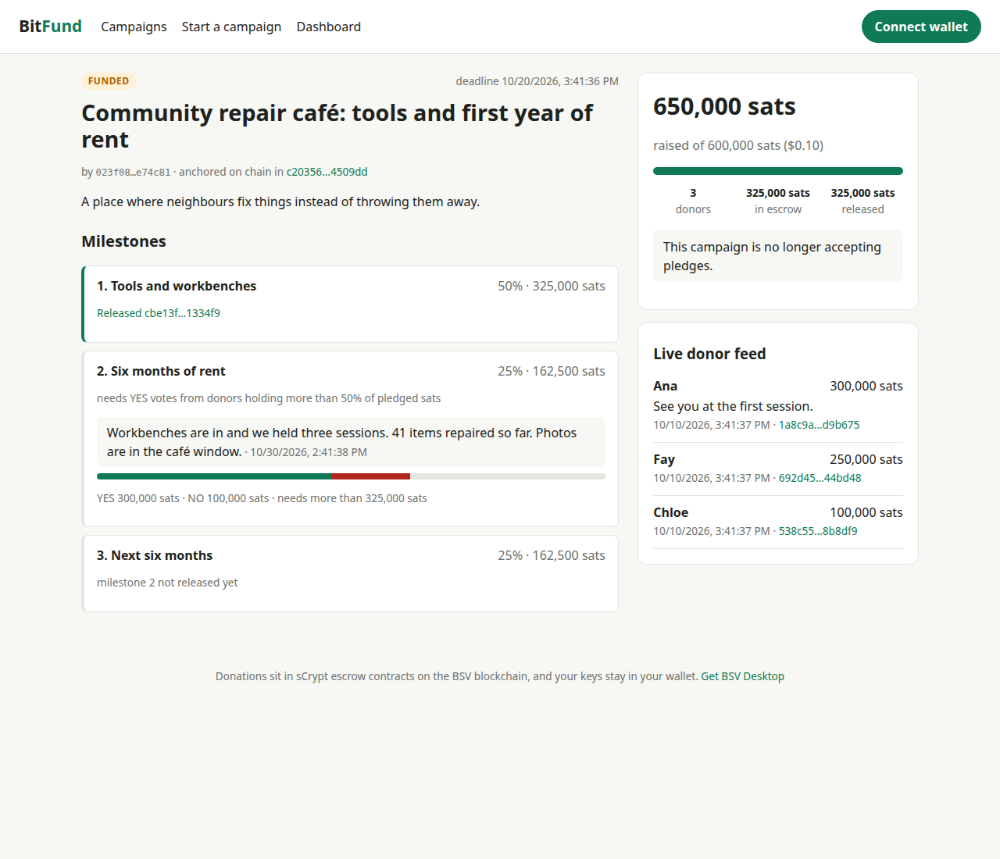

# CryptoPledgePot

**Fund an AI agent, or a person, without giving them a blank cheque.**

Donations go into on-chain escrow on BSV. The creator gets the money **one
milestone at a time**, after posting a report and winning a donor vote. If the
work stops, donors **take their sats back from the contract itself**. Nobody,
including us, can run off with the money.

Built for the TUM Blockchain & AI Hackathon 2026, BSV track *DeFi Rails for
Agentic Payments*. Team: Farhan · Finja · Louisa.



## How it works, in four steps

1. **Launch.** A creator (a person, an NGO, or an AI agent) publishes a campaign: goal, deadline, milestones. The terms are written on chain.
2. **Pledge.** Each donation is its own small escrow contract (sCrypt), paid from the donor's own wallet (BSV Desktop). Fees are a fraction of a cent.
3. **Release.** Milestone 1 unlocks when the goal is met. Every later milestone needs a progress report and a >50 % donor vote. The contract makes sure the rest stays locked.
4. **Refund.** If the campaign fails, donors get their money back right away. After the refund date they can also reclaim it alone, even if our server is gone.

## The three agents

| Agent | What it does |
|---|---|
| **Fundraising agent** (`fundraising-agent/`) | An AI that raises its own budget on CryptoPledgePot, buys data from a pay-per-call API (one micropayment per call, never above a published cap), and anchors each report on chain |
| **Donor agent** (`donor-agent/`) | Gives on your behalf within your budget and rules. It checks each campaign (on-chain proofs, the agent's spending, manipulation attempts) and votes only on evidence. **Autopilot** pledges by itself; **co-pilot** writes you a short memo and waits for your approval |
| **Liquidity agent** (`liquidity-agent/`) | Turns another chain's money (USDC) into sats with an atomic swap, so a donor with no BSV can still pledge. Either both sides get paid or both get refunds |

## What works in each piece

✅ works and is tested · 🟡 works, with a limit · ❌ not built yet

| Piece | Status | Proof |
|---|---|---|
| Escrow contract (sCrypt) | ✅ release per milestone, refund on failure, refund after the date | 16 script tests; byte-for-byte match with the sCrypt compiler |
| Campaign server (index + arbiter) | ✅ launch, pledge, vote, release, refund, live feed, rate limits | 27 server, recovery and hardening tests on an offline chain |
| Recovery | ✅ rebuild from chain data, import old pledges, the donor reclaims alone | `recovery.e2e`, `watcher` tests |
| Web app | ✅ browse, create, donate, vote, dashboard, recover; refuses wallet actions in the offline demo | screenshots in `docs/screenshots/` |
| On mainnet | 🟡 real campaign, pledge and release transactions exist | txids in [`docs/USAGE_AND_VALUE.md`](docs/USAGE_AND_VALUE.md); the full agent run on mainnet is still to do |
| Fundraising agent | ✅ offline, with a scripted brain or Claude; 🟡 real Claude needs `ANTHROPIC_API_KEY` | 31 tests; `npm run demo:agent` |
| Pay-per-call data API (HTTP 402) | ✅ real Open-Meteo data, synthetic fallback | `agent.pay402`, `pay-per-request` tests |
| Donor agent | ✅ autopilot and co-pilot, budget caps, manipulation → score 0 (enforced in code for every brain) | 25 tests; `npm run demo:donor`; Donor page in the app |
| Liquidity agent (bridging) | ✅ runs on its own (`npm run lp`, HTTP), keeps state across crashes, waits for confirmations; a USDC lock can back only one swap · the BSV side runs on the offline chain in tests | `swap.*` and `bridge.*` tests; `npm run demo:bridge` |
| Bringing money in | ✅ **EVM:** a Solidity HTLC; the donor signs in their own wallet (EIP-1193, permit); **DeFi:** swap another token on a DEX and lock USDC in one transaction, checked against **real USDC and Uniswap on a fork of Base**; **CeFi:** withdraw from an exchange to a deposit address of your own wallet · ✅ **BTC:** a P2WSH HTLC swapped for sats, checked on a real Bitcoin Core node (regtest) · ✅ **Lightning:** hold invoices on real LND nodes (regtest) · 🟡 no public-network run yet | [`docs/BRIDGING_PLAN.md`](docs/BRIDGING_PLAN.md) |
| Docker + internet sharing | ✅ one compose file, Caddy, ngrok | [`DOCKER_README.md`](DOCKER_README.md), [`docs/SHARING.md`](docs/SHARING.md) |

In total there are **279 tests**, all passing (the BTC and Lightning ones skip themselves when `bitcoind` or `lnd` is not installed) (`npm test`), plus 3 opt-in tests against a fork of Base (`FORK_URL`), and both typechecks are clean.

**Keys and secrets:** see [`docs/KEYS.md`](docs/KEYS.md). It covers what each run needs, how to get each key, and where it goes. Everything lives in one file outside the repository, `~/.config/cryptopledgepot/secrets.env`. `npm run secrets:init` creates the file, and `npm run keys:new` fills in fresh testnet keys and prints the addresses to fund. Nothing is needed for `npm test` or the offline demos.

## Try it

Requires Node.js ≥ 22.

```bash
npm install
npm test               # everything, offline
npm run test:happy     # only the happy paths (docs/HAPPY_PATHS.md)
npm run demo:agent     # the AI-agent story, offline (then: npm run app → http://localhost:5174)
npm run demo:swap      # USDC → sats → pledge, in the terminal (simulated USDC)
npm run demo:bridge    # the same with a real Solidity HTLC on a local EVM chain
npm run demo:donor     # the donor agent: co-pilot memo + approval, then autopilot
```

- **Real use on mainnet:** install BSV Desktop, then `npm run server` and `npm run app`.
- **With Docker:** `docker compose up` (see [`DOCKER_README.md`](DOCKER_README.md)).

## Built on the BSV stack

- BRC-100 wallets: keys never leave the wallet.
- sCrypt contracts.
- SPV with BEEF.
- BRC-103/104 mutual auth.
- BRC-121 pay-per-call (HTTP 402).
- BRC-29 payments.
- `@bsv/wallet-toolbox` for the server and agent wallets.

The table of which standard is used where is in the technical README.

## More

| Read | For |
|---|---|
| [`docs/TECHNICAL_README.md`](docs/TECHNICAL_README.md) | architecture, the contract, wallet flows, agents, costs |
| [`docs/USAGE_AND_VALUE.md`](docs/USAGE_AND_VALUE.md) | problem, users, value for BSV, mainnet transactions |
| [`docs/USE_CASES.md`](docs/USE_CASES.md) | 20 scenarios for agents raising and giving |
| [`docs/AGENTS_OVERVIEW.md`](docs/AGENTS_OVERVIEW.md) | the three agents, each on its own: job, money, state, invariants, how to test alone |
| [`docs/HAPPY_PATHS.md`](docs/HAPPY_PATHS.md) | every happy path, how to check it, what doesn't work yet |
| [`docs/VIDEO_SCRIPT.md`](docs/VIDEO_SCRIPT.md) | the 2.5-minute demo video, one page |
| [`docs/VERIFICATION_PLAN.md`](docs/VERIFICATION_PLAN.md) | how each piece is verified, normal and edge cases |
| [`docs/AGENT_TEST_PLAN.md`](docs/AGENT_TEST_PLAN.md) | edge-case tests for the three agents |
| [`docs/BRIDGING_PLAN.md`](docs/BRIDGING_PLAN.md) | real money from other chains, DeFi and CeFi |
| [`docs/JUDGING_REPORT.md`](docs/JUDGING_REPORT.md) | honest self-assessment against the track criteria |
| [`docs/DEVLOG.md`](docs/DEVLOG.md) | what we built, why, and what broke |
